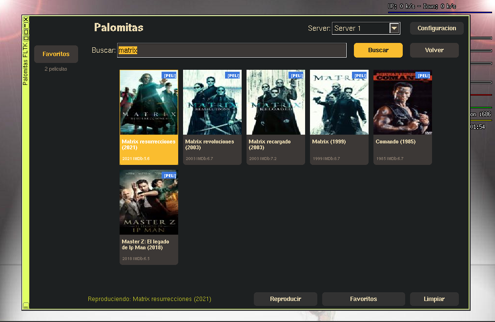
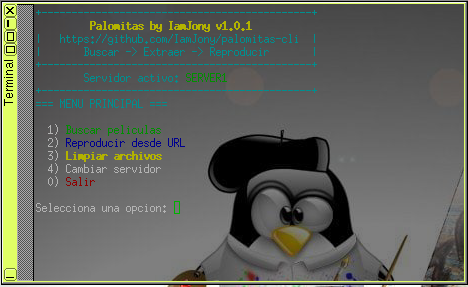

# Palomitas

**Palomitas** es una interfaz gráfica (GUI) desarrollada en **FLTK** para **FLINUX** y **Tiny Core Linux**. Funciona como un *wrapper* (envoltorio) visual del proyecto palomitas-cli potente script en Bash diseñado para buscar y reproducir peliculas, series y anime en español directamente desde la terminal.

## Características

- **GUI en FLTK** con grilla de carátulas, temas, favoritos y búsqueda.
- **CLI en bash** para usar desde terminal. Lanza con el comando `palomitas-cli-launcher`
- Reproductor con `mplayer` o `mpv` + `yt-dlp`.
- Favoritos persistentes en `~/.config/palomitas-fltk/data.json`.

## Dependencias

### Para compilar
- `compiletc` (g++, make)
- `fltk-1.3-dev`
- `libX11-dev`
- `libXft-dev`
- `squashfs-tools`

### Para ejecutar
- `fltk-1.3`
- `mplayer` (o `mpv`)
- `curl`
- `jq`
- `bash`
- `perl5`
- `yt-dlp`
- `python3` (requerido por `yt-dlp`)

## Novedades

1. **Nuevo servidor de streaming**: soporta películas, series y anime. *(Nota: actualmente no soporta carátulas).*
2. **Selector de reproductor**: ahora puedes elegir entre `mplayer` y `mpv` desde la configuración.
3. **Interfaz CLI actualizada**: mejoras en la usabilidad y salida de datos.

## Observación importante

Asegúrate de que **todas las dependencias se carguen al inicio (`on boot`)** en Tiny Core o FLINUX. Presta especial atención a **`perl5`**, ya que es un requisito crítico para que **Server 2** pueda extraer los enlaces HLS de los videos embebidos. Sin `perl5`, la reproducción del contenido de este servidor fallará.
