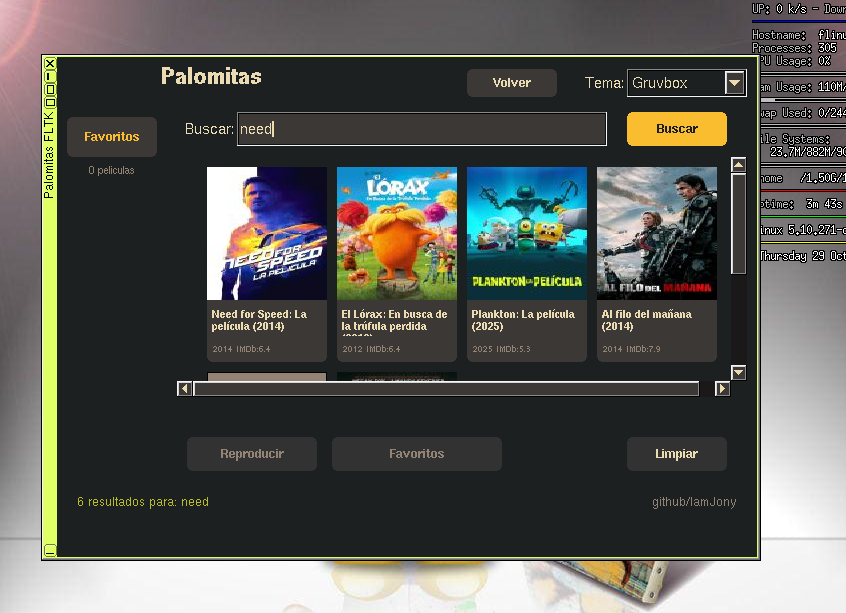
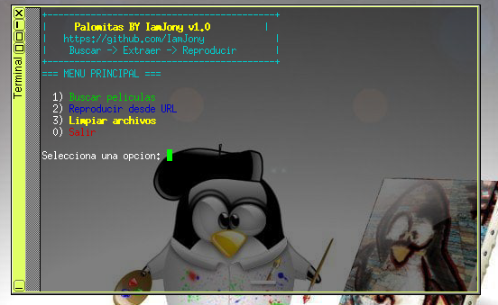

# Palomitas

Busca y reproduce películas en español desde la terminal de Linux o mediante una interfaz gráfica en FLTK, compatible con FLINUX y Tiny Core Linux

## Características

- **GUI en FLTK** con grilla de carátulas, temas, favoritos y búsqueda.
- **CLI en bash** para usar desde terminal. Lanza con el comando `palomitas-cli-launcher`
- Reproductor con `mplayer` o `mpv` + `yt-dlp`.
- Favoritos persistentes en `~/.config/palomitas-fltk/data.json`.

## Dependencias

### Para compilar
- `compiletc` (g++, make)
- `fltk-1.3-dev`
- `libX11-dev`
- `libXft-dev`
- `squashfs-tools`

### Para ejecutar
- `fltk-1.3`
- `mplayer` (o `mpv`)
- `curl`
- `jq`
- `bash`
- `yt-dlp`
- `python3` (requerido por `yt-dlp`)
- `ffmpeg` (opcional, mejora la extracción con `yt-dlp`)
